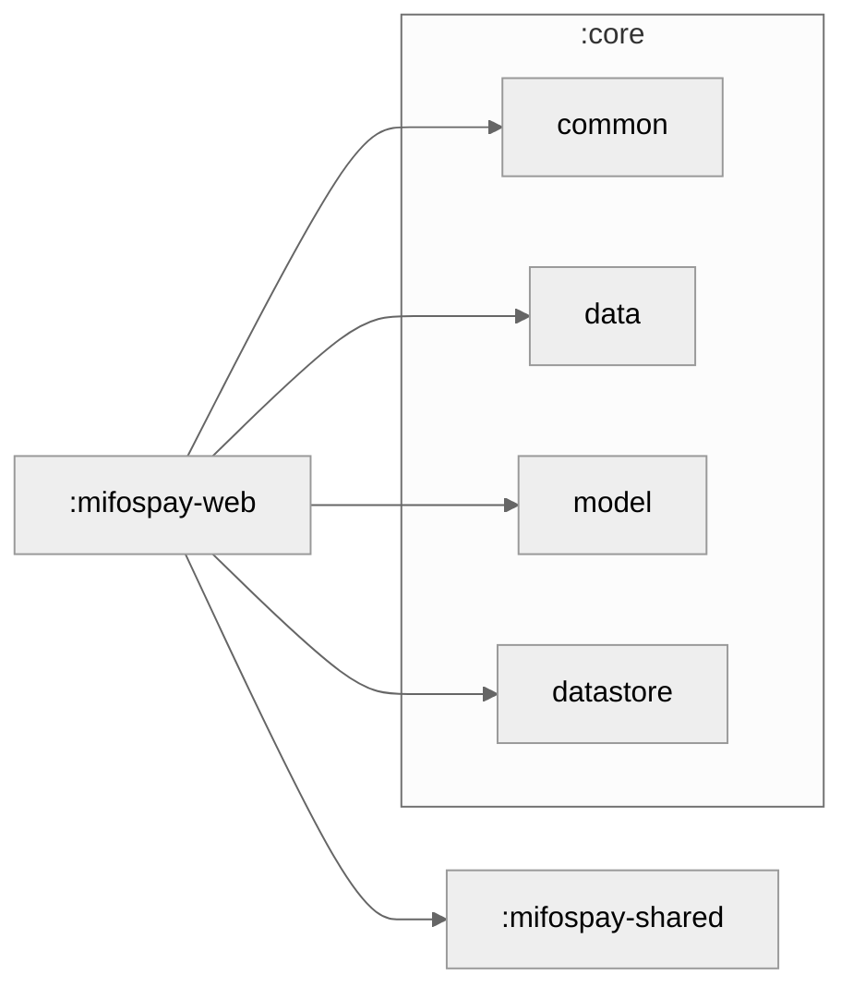

### Production builds

Run `./gradlew :cmp-web:jsBrowserDistribution` to build the web distribution.
Production Webpack configuration in `webpack.config.d/production.js` skips
JavaScript minification and bundled source maps to keep Compose packaging within
CI resource limits. Kotlin production compilation still eliminates dead code.
The resulting JavaScript is larger than a minified bundle; development builds
keep their source maps.

### Module Graph

